# Task Manager — React Native proof of concept

[](https://github.com/getupworkdev/rn-task-manager-poc/actions/workflows/ci.yml)

> **Demo project with a mock API.** Tasks live in memory inside the app and reset on restart. No
> real backend, no accounts, no secrets.

A small task manager built the way a production React Native app should be: typed API layer,
server state in React Query with optimistic updates that roll back cleanly, validated forms,
accessible UI, dark mode and tests.

- **Live web demo:** https://rn-task-manager-poc.vercel.app
- **Android:** run it in Expo Go, or build an installable APK with the `preview` profile (see
  [Android build](#android-build)).

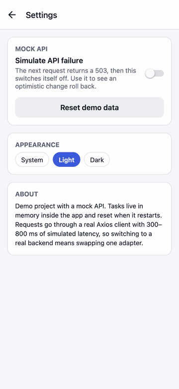

_Settings → "Simulate API failure" is switched on, then a task is ticked. The tick shows
instantly, the request fails, the change is undone and a toast explains why._

## What it demonstrates

- **Expo SDK 57 + TypeScript (strict)**, one codebase for iOS, Android and web.
- **React Navigation native stack**: list, details, create task as a modal, settings; deep links on
  web (`/tasks/:id`, `/new`, `/settings`).
- **Typed Axios client** with a single error type (`ApiError`) for the UI. The mock server plugs in
  as an Axios adapter, so moving to a real backend means changing one line.
- **Mock REST API** with 300–800 ms latency: `GET /tasks` (status filter, sort by due date /
  priority / newest, pagination), `GET /tasks/:id`, `POST /tasks`, `PATCH /tasks/:id`,
  `DELETE /tasks/:id`, plus a switch that makes the next request fail.
- **TanStack React Query**: infinite list, cached details that open instantly from the list row,
  and **optimistic create, update and delete with rollback** and an error toast on failure.
  List filters and the detail cache stay consistent; a task that changes status leaves filtered
  lists straight away.
- **Swipe to delete with Undo**: the task disappears at once, the `DELETE` only goes out when the
  undo window closes, and the task comes back if that request fails.
- **FlashList** with pull to refresh, infinite scroll, loading skeletons, empty and error states
  with retry.
- **React Hook Form + Zod**: inline validation (title length, real calendar dates), shared by the
  create and edit screens, keyboard-safe on iOS and Android.
- **Polish**: light and dark themes (system or manual), safe areas, font scaling, accessibility
  labels, roles and actions (screen-reader users can delete without swiping), and an unsaved
  changes prompt when leaving an edit, including with the Android back button.
- **Quality**: Jest + React Native Testing Library, ESLint + Prettier, and GitHub Actions running
  lint, format, typecheck and tests on every push.

## Architecture

```
App.tsx                    providers + navigator
src/
├── api/                   typed REST layer
│   ├── client.ts          Axios instance, ApiError, adapter switch
│   ├── tasks.ts           list / get / create / update / remove
│   └── types.ts           Task, TaskPage, filters, labels
├── mocks/                 in-app mock server (Axios adapter)
│   ├── mockServer.ts      routes, validation, latency, failure switch
│   └── seed.ts            40 sample tasks
├── features/
│   ├── tasks/
│   │   ├── hooks.ts       queries + optimistic mutations
│   │   ├── cache.ts       keeps every cached list and the detail in sync
│   │   ├── queryKeys.ts
│   │   ├── schema.ts      Zod form schema + mapping to the API payload
│   │   ├── components/    TaskRow, TaskForm, SortMenu, skeleton
│   │   └── screens/       TaskList, TaskDetail, CreateTask
│   └── settings/          failure switch, theme, reset demo data
├── components/            Toast (with action), Button, Chip, Card, states
├── navigation/            native stack, linking, typed params
└── theme/                 light/dark tokens, ThemeProvider
```

How a change flows:

```
Screen ──► mutation hook ──► onMutate: snapshot caches, apply change everywhere (instant UI)
                         └─► tasksApi ──► Axios ──► mock adapter (or real API)
                                   success: write server copy into list + detail caches
                                   failure: restore snapshot, show error toast
                         └─► onSettled: refetch lists in the background
```

## Run it

```bash
npm install
npm run web        # browser
npm run ios        # iOS simulator (needs Xcode)
npm run android    # Android emulator or device (needs Android Studio)
```

The app uses only Expo Go compatible packages, so `npx expo start` and scanning the QR code with
Expo Go also works.

### Checks

```bash
npm test           # Jest + React Native Testing Library
npm run lint       # ESLint
npm run typecheck  # tsc --noEmit
npm run build:web  # static web export in dist/
```

### Android build

`eas.json` has a `preview` profile that produces an installable APK:

```bash
npx eas-cli@latest build -p android --profile preview
```

### Using a real API

In `src/api/client.ts`, replace the mock adapter with your backend URL:

```ts
export const apiClient = createApiClient(undefined, process.env.EXPO_PUBLIC_API_URL);
```

Everything above the client (hooks, cache updates, screens) stays the same.

## Tests

| Area                     | What is covered                                                                                                                                         |
| ------------------------ | ------------------------------------------------------------------------------------------------------------------------------------------------------- |
| API layer                | pagination, status filter, both sorts, full CRUD, 404 and 422 errors, simulated 503                                                                     |
| Query and mutation hooks | infinite paging; optimistic update, create and delete; **rollback and toast on failure**; undo before the delete is sent; restore when the delete fails |
| Form validation          | title length and trimming, date format, impossible dates, payload mapping                                                                               |
| List screen              | skeleton → rows, empty state, error state with working retry, status filter, opening a task                                                             |

## Screenshots

| Screen               | Light                                                                 | Dark                                                                 |
| -------------------- | --------------------------------------------------------------------- | -------------------------------------------------------------------- |
| Loading              | 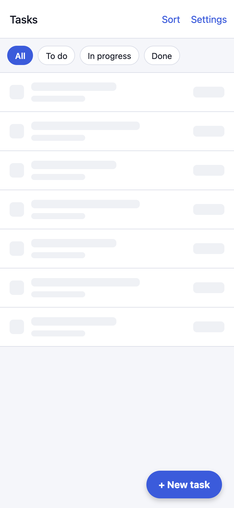    | 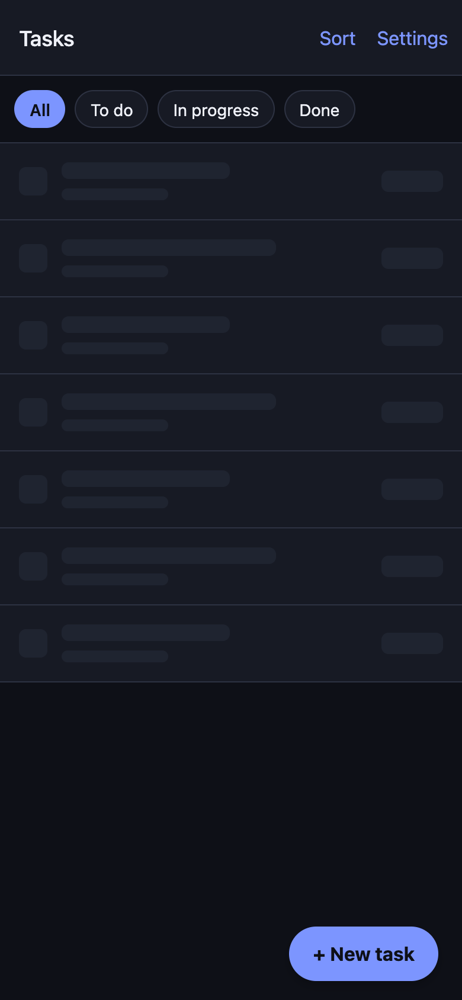    |
| Task list            | 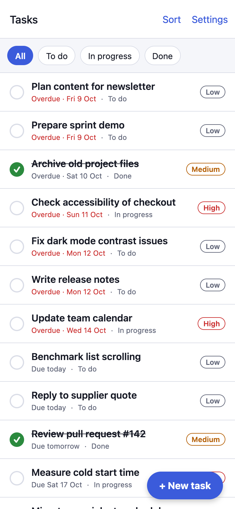            | 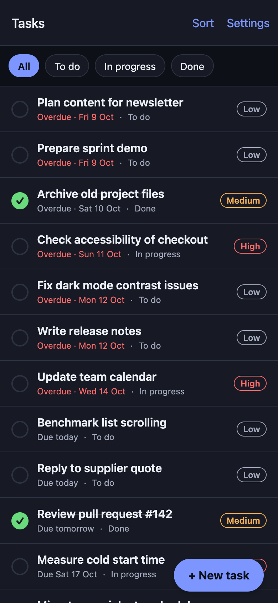            |
| Sort menu            | 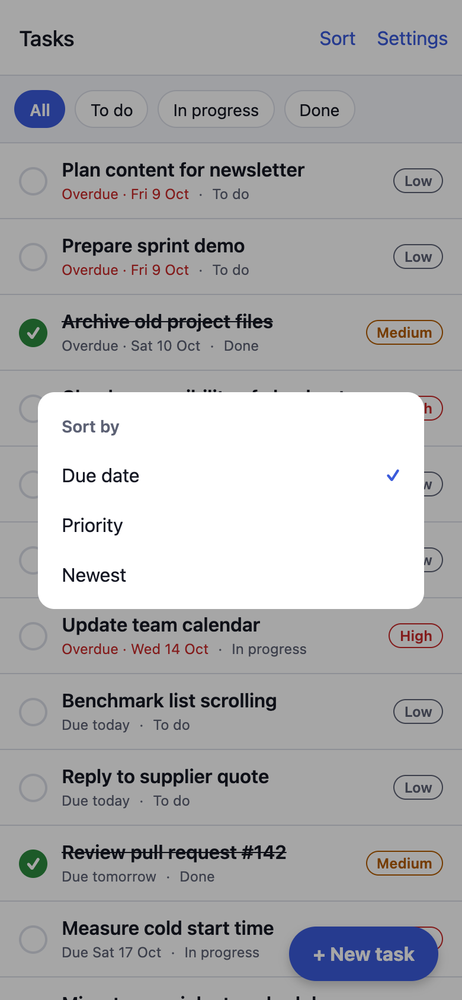       | 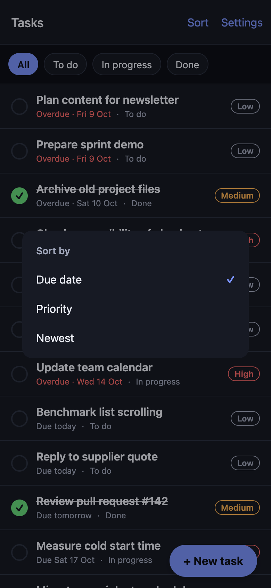       |
| Task details         | 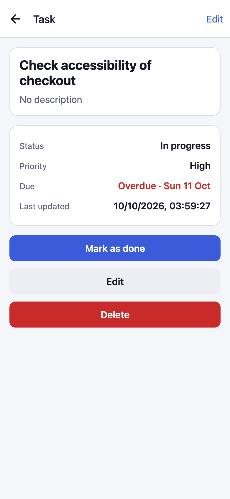          | 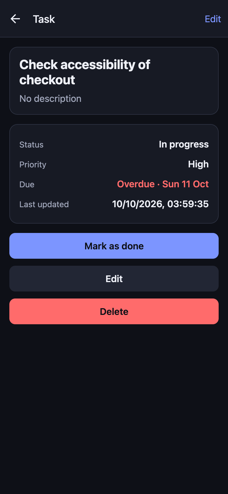          |
| Edit with validation | 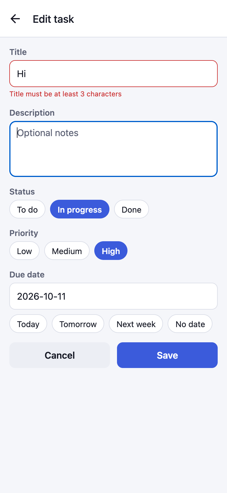 | 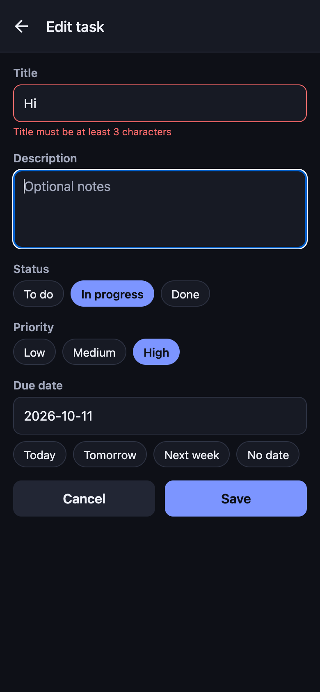 |
| Create task          | 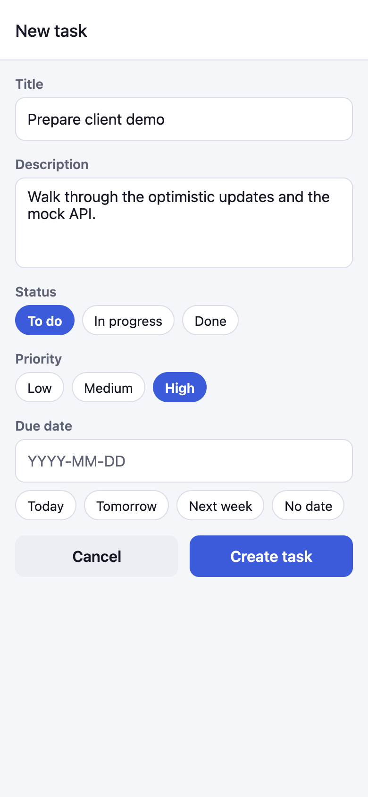          | 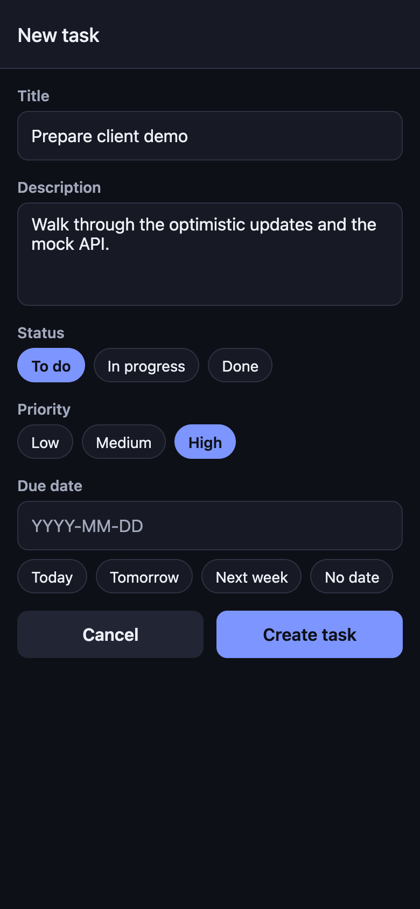          |
| Settings             | 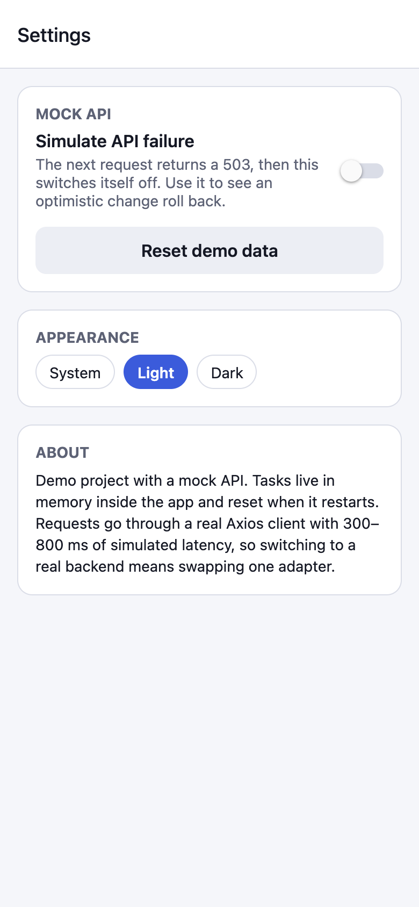        | 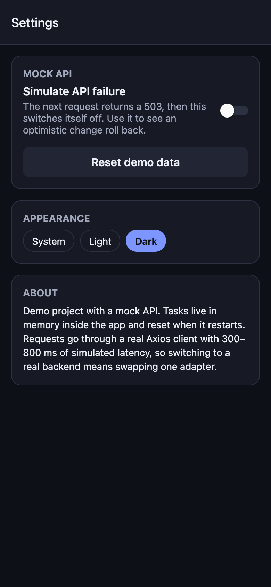        |
| Error state          | 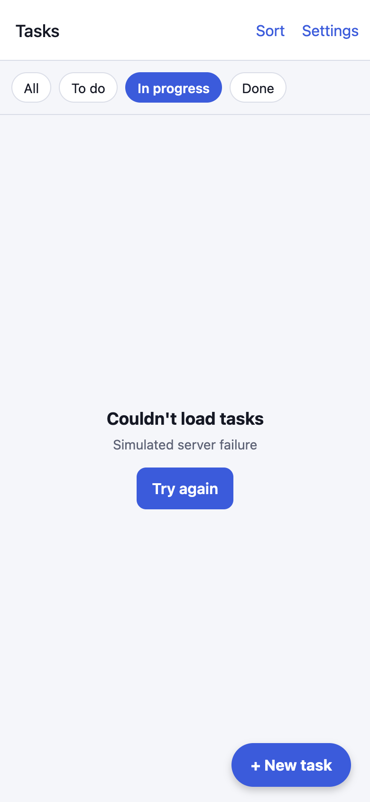           | 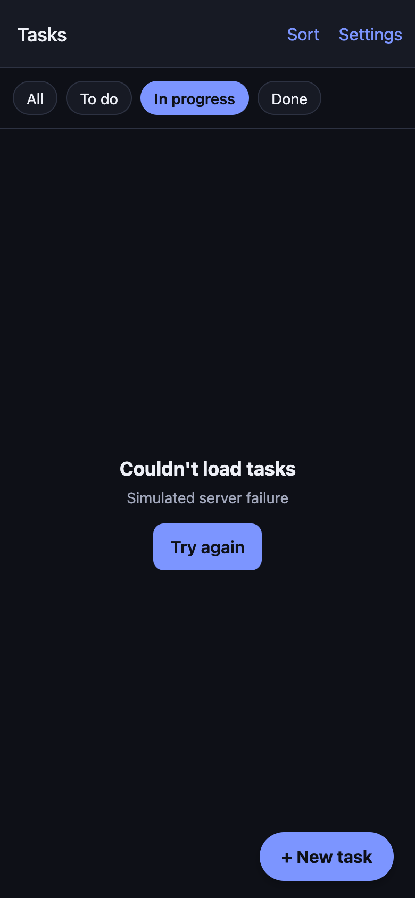           |

Screenshots are from the web build at phone size.

## Known limits

- The due date is a text field (`YYYY-MM-DD`) with quick picks, to stay identical on web, iOS and
  Android without a native date picker.
- Data is not persisted between launches; that is the point of the mock.

## License

MIT
